# Doctor Tracker: Frontend

> Admin web app for managing doctors and their patients, with a live analytics dashboard.
> Built with **Next.js 14 (App Router)**, Tailwind CSS, TanStack Query and Recharts.
> The REST API lives in a separate repository: **[doctor-tracker-backend](REPLACE_WITH_BACKEND_REPO_URL)**.

## Elevator pitch

Doctor Tracker is a secure administrative portal where hospital staff sign in to register doctors, add and maintain the patients under each doctor, and see at a glance how the care network is growing. Lists are searchable, filterable by date and condition, sortable and paginated, and every view is shareable by URL. A dashboard turns the same data into headline numbers and charts (registrations over time, patients per doctor, conditions, specializations). The interface is responsive down to a phone, keyboard accessible, and built to feel fast: instant skeleton states, debounced search and no full-page reloads.

|                       |                                                          |
| --------------------- | -------------------------------------------------------- |
| **Live app**          | REPLACE_WITH_VERCEL_URL                                  |
| **Live API**          | REPLACE_WITH_RENDER_URL (docs at `/docs`)                |
| **Demo login**        | `admin@example.com` / `ChangeMe123!` (one-click button on the login page) |
| **Backend repo**      | REPLACE_WITH_BACKEND_REPO_URL                            |

> The API runs on a free tier that sleeps when idle. The first request after a pause can take up to a minute; the login page wakes it up in the background and tells you when that is happening.

---

## What is implemented (mapped to the brief)

| Requirement                                                           | Where / how                                                                                       |
| --------------------------------------------------------------------- | ------------------------------------------------------------------------------------------------- |
| Secure login, all routes protected                                    | HttpOnly session cookie, Next.js **middleware** guard, API verifies JWT + role on every request   |
| Create doctor (name, specialization, hospital, phone, email)          | Slide-over form, schema validation on client and server, server errors shown under the right field |
| List, search, filter (date and others), paginate doctors              | `/doctors`: search, specialization, hospital, joined-date range, sort, page size, numbered pagination |
| Doctor profile: view patients, **add** and **delete** patients        | `/doctors/[id]`: stats, condition breakdown, paginated patient table, add/edit/delete in place    |
| Patients page: list, **edit**, delete, pagination, search, filters    | `/patients`: search, condition, gender, doctor, registered-date range, sort, add/edit/delete       |
| Dashboard analytics + charts                                          | Totals, patients per doctor, date-based registrations (7d / 30d / 12m), conditions, specializations, recent patients |
| Modern, responsive, smooth UX                                         | Custom design system, mobile drawer and card lists, skeleton loaders, empty/error states, toasts  |
| Clear navigation                                                      | Sidebar (collapsible) / mobile drawer, breadcrumbs, back links                                    |
| Performance                                                           | See [Technical decisions](#technical-decisions) and [Performance notes](#performance-and-ux-notes) |

---

## Setup guide

**Prerequisites:** Node.js 20+, and the [backend](REPLACE_WITH_BACKEND_REPO_URL) running locally (needs MongoDB).

```bash
# 1. Start the API first (see the backend README): it should answer on http://localhost:5000

# 2. Install and configure the frontend
git clone REPLACE_WITH_FRONTEND_REPO_URL
cd doctor-tracker-frontend
npm install
cp .env.example .env.local        # Windows: copy .env.example .env.local

# 3. Run
npm run dev                        # http://localhost:3000
```

`.env.example` documents every variable:

| Variable                   | Required | Purpose                                                                                 |
| -------------------------- | -------- | --------------------------------------------------------------------------------------- |
| `BACKEND_URL`              | yes      | Where Express runs. Next.js proxies `/api/*` to it (server side only, never sent to the browser). |
| `NEXT_PUBLIC_DEMO_EMAIL`   | no       | Shows the "Demo access" card on the login page when set together with the password.     |
| `NEXT_PUBLIC_DEMO_PASSWORD`| no       | Throw-away demo password (public by design).                                            |

Other scripts: `npm run build` (production build), `npm start` (serve it), `npm run lint`, `npm run format`.

**Deploy (Vercel):** import the repo, set `BACKEND_URL` to your API URL (for example `https://doctor-tracker-api.onrender.com`), deploy. No other configuration is needed because the browser only ever talks to the Vercel origin.

---

## System architecture

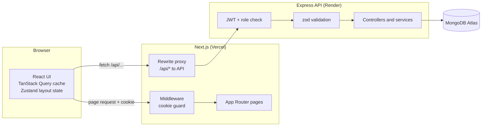

**Sign-in flow.** The browser never sees or stores a token.

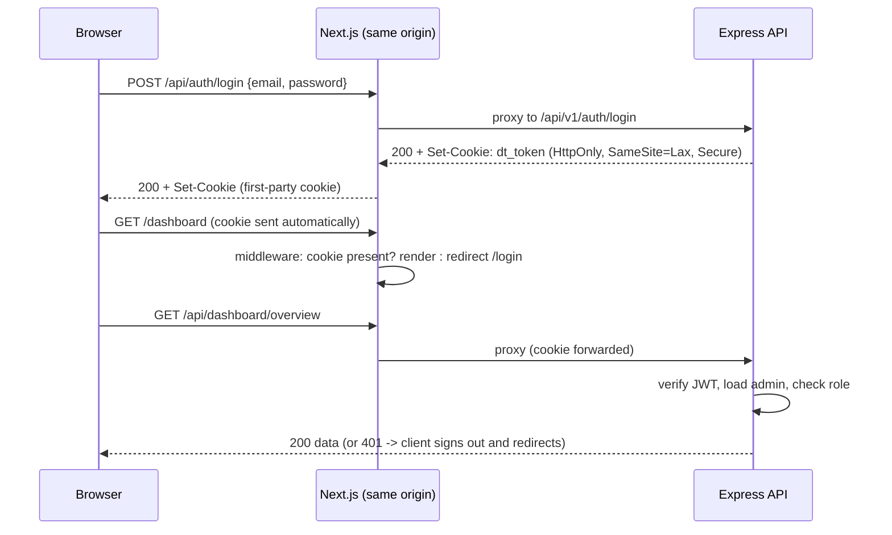

**Data flow rules**

- **Server state** (doctors, patients, dashboard) lives in TanStack Query: one cache, automatic refetch after mutations.
- **View state** (page, search, filters, sort) lives in the URL query string.
- **UI state** (sidebar collapsed, mobile drawer) lives in a tiny Zustand store.
- Forms are React Hook Form + zod. Server-side field errors (422/409) are mapped back onto the inputs.

**Folder structure**

```
src/
  app/                    # Routes (App Router): login, (protected)/dashboard|doctors|doctors/[id]|patients
  middleware.js           # Server-side route guard
  components/
    ui/                   # Design-system primitives: Button, Input/Select/Field, Badge, Avatar, Sheet, ConfirmDialog, RowMenu, Skeleton ...
    data/                 # Reusable list pieces: DataTable, Pagination, SearchInput, FilterBar
    layout/               # AppShell, SidebarContent, Topbar
    dashboard/            # KpiStrip, charts, lists, skeleton
    doctors/  patients/   # Feature views and forms
    auth/                 # LoginView
  hooks/                  # useListParams (URL state), useCountUp
  lib/                    # api (axios), queries (TanStack hooks), schemas (zod), constants, utils
  store/                  # Zustand UI store
```

---

## Technical decisions

### 1. Session in an HttpOnly cookie, delivered through a same-origin proxy (instead of a JWT in localStorage)

**The problem.** The usual quick approach is: log in, receive a JWT, keep it in `localStorage`, attach it to every request. It works, but any XSS bug (or a compromised npm dependency) can read `localStorage` and steal the session. Route protection then has to happen in the browser after the page has rendered, which causes a flash of protected UI and cannot protect server-rendered pages.

**Options considered**

| Option                                             | Verdict                                                                                                  |
| -------------------------------------------------- | -------------------------------------------------------------------------------------------------------- |
| JWT in `localStorage`                              | Simple, but readable by any script on the page; client-only route protection.                            |
| Cookie set by the API on its own domain (Render)   | Cross-site cookie: needs `SameSite=None; Secure` + CORS credentials, and browsers increasingly block third-party cookies. Also invisible to Next.js middleware (different domain). |
| **Cookie + Next.js `rewrites` proxy (chosen)**     | The browser only talks to the Vercel origin; Next.js forwards `/api/*` to Express. The cookie is **first-party**, so it can be `HttpOnly; Secure; SameSite=Lax` and Next.js middleware can see it. |

**How it works**

- The API sets `dt_token` (signed JWT, 24h) as `HttpOnly`. JavaScript cannot read it, so XSS cannot exfiltrate it.
- `SameSite=Lax` means the browser does not attach it to cross-site POST requests, which covers CSRF for this JSON API.
- `middleware.js` runs before any page renders. No cookie: redirect to `/login?next=...`. This removes the "flash of protected content".
- The middleware only checks that the cookie **exists**. The real authorization (signature, expiry, admin still active, role) is done by the API on **every** request. If it answers 401, the axios interceptor clears the stale cookie and redirects to the login page, so there is no redirect loop.
- `?next=` is validated to be a same-site path, which prevents open-redirect abuse.

**Trade-offs, honestly.** Every API call takes one extra hop through Next.js (a few ms). On a cold free-tier backend the proxy can time out, which is why the login page pings `/health` as soon as it loads. A stateless JWT cannot be revoked before it expires; the API mitigates this by re-checking `isActive` on each request and keeping the lifetime short. Refresh-token rotation would be the next step for a production system.

### 2. TanStack Query + URL state instead of Redux or Context

**The problem.** Almost all state in this app is *server data* (lists, details, analytics) that must be fetched, cached, kept fresh after edits and shown with loading/error states. Putting that in Redux or Context means writing (and testing) loading flags, cache invalidation and request de-duplication by hand, and any Context value change re-renders every consumer.

**Decision.** Split state by what it really is:

| Kind of state                              | Tool                    | Why                                                                                      |
| ------------------------------------------ | ----------------------- | ---------------------------------------------------------------------------------------- |
| Server data                                | **TanStack Query**      | Caching, request de-duplication, background refresh, `invalidateQueries` after mutations |
| Page, search, filters, sort, page size     | **URL query string**    | Survives refresh, back/forward and sharing; no extra store to keep in sync               |
| Sidebar / mobile drawer                    | **Zustand** (6 lines)   | Tiny global UI state; components subscribe to just the slice they need (no wasted re-renders) |
| Form fields                                | **React Hook Form**     | Uncontrolled inputs: typing does not re-render the whole form                            |

**What this buys in practice**

- `placeholderData: keepPreviousData`: when you change page or filter, the previous rows stay visible (slightly dimmed) until the new ones arrive, so the table never jumps to empty.
- Changing search or filters creates a new query key, and in-flight requests for stale keys are ignored. That removes the classic "slow response overwrites the newest result" race.
- After adding, editing or deleting a patient, one `invalidateQueries` call refreshes the patient list, the doctor's profile counters, the doctors list (`patientCount`) and the dashboard. There is no manual "refetch everything" code.
- The search box is debounced (350 ms) and writes to the URL with `history.replaceState`, so typing does not spam the API or the browser history.

**Trade-off.** Redux would give a single inspectable store and time-travel debugging, which is valuable in apps with lots of client-side business logic. This app has very little of that, so the extra ceremony would not pay for itself.

---

## Performance and UX notes

- **Fewer re-renders:** Zustand selectors, uncontrolled forms (React Hook Form), memoized table columns, and `React.memo` on the dashboard charts so a background refetch with unchanged data does not redraw them.
- **Perceived speed:** skeletons for first load, dimmed previous data for subsequent loads, count-up numbers (disabled for `prefers-reduced-motion`).
- **Resilience:** friendly error states with a retry button, a 404 state for unknown doctors, a session-expiry flow, and a "server is waking up" message for slow cold starts.
- **Accessibility:** semantic table/`aria-sort`, labelled controls, visible keyboard focus, Radix dialogs (focus trap, ESC), `role="radiogroup"` for gender and range toggles, text alternatives for charts.
- **Responsive:** tables become card lists below `md`, navigation becomes a drawer below `lg`, forms are full-width sheets on phones. Verified with no horizontal scroll at 390 px.
- **Fonts** are self-hosted through `@fontsource` (no third-party font request).

## Scalability considerations

- **Large lists:** server-side pagination, search and filtering only; the client never downloads a full collection.
- **Dropdowns with many doctors:** `/doctors/options` is capped at 500 rows and sorted by name. Beyond that, swap the native select for an async, searchable combobox.
- **Deep pagination:** offset pagination is fine for admin lists; for very large collections move to cursor (keyset) pagination (see the backend README).
- **Bundle size:** route-level code splitting by the App Router; charts load only on the dashboard (about 118 kB for that route, 3 to 4 kB for the others).
- **Stateless frontend:** no server-side session store, so it scales horizontally on any host.

---

## Visual evidence

### Desktop

| Sign in | Dashboard |
| :---: | :---: |
| 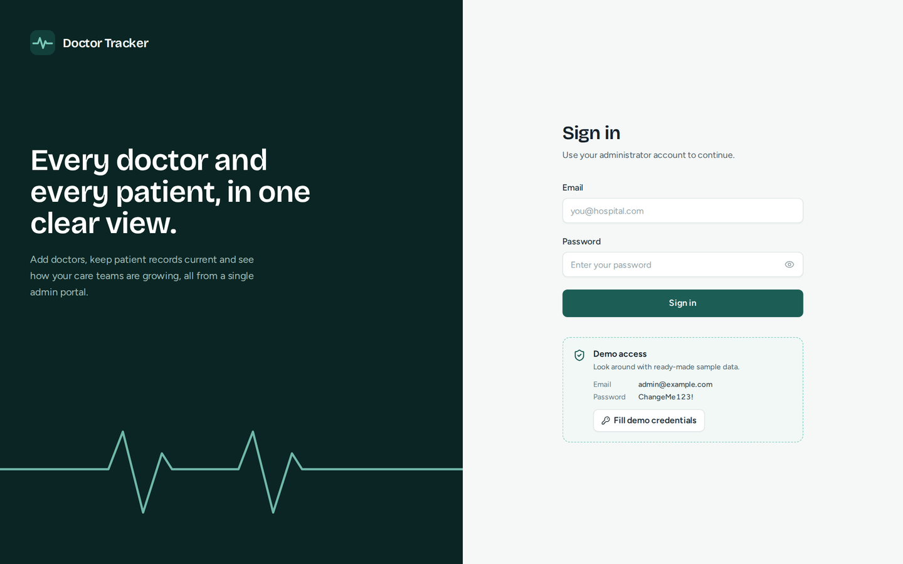 | 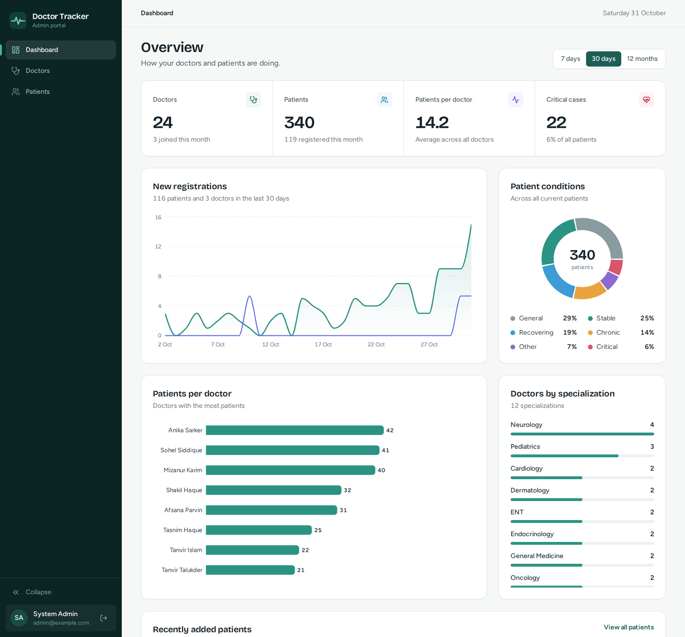 |

| Doctors (search, sort, paginate) | Doctor profile (stats, patients) |
| :---: | :---: |
| 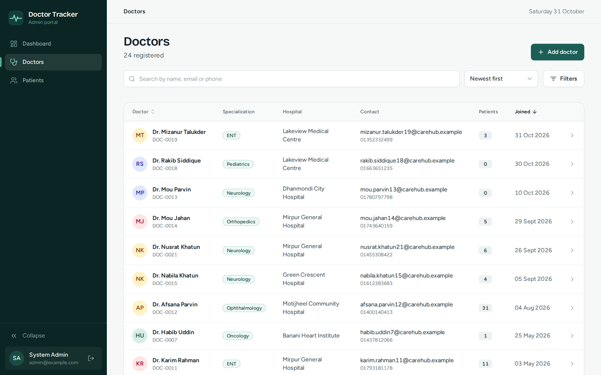 | 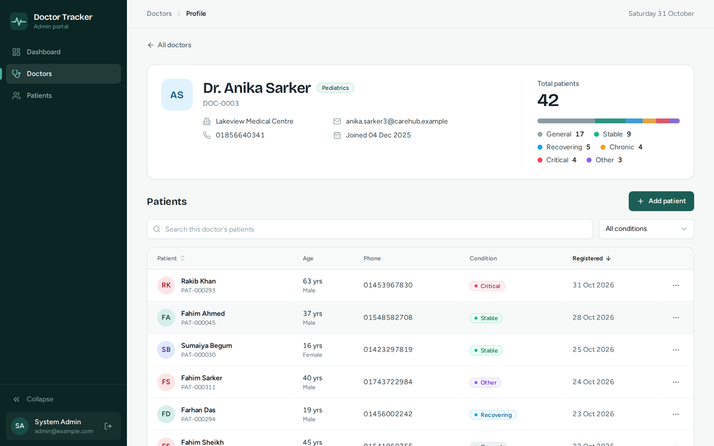 |

| Patients (filters + chips) | Add patient (slide-over form) |
| :---: | :---: |
| 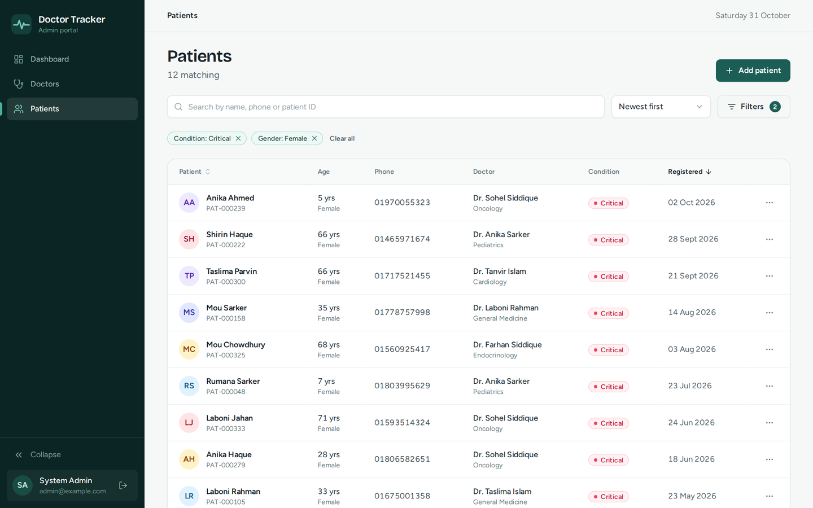 | 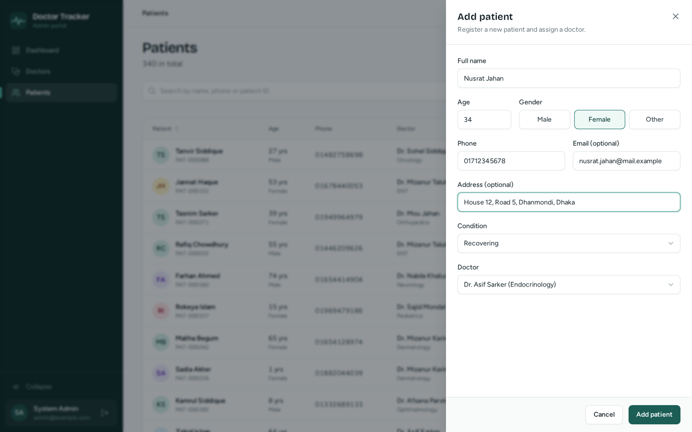 |

### Mobile (390 px)

| Sign in | Dashboard | Navigation | Doctors | Add patient |
| :---: | :---: | :---: | :---: | :---: |
| 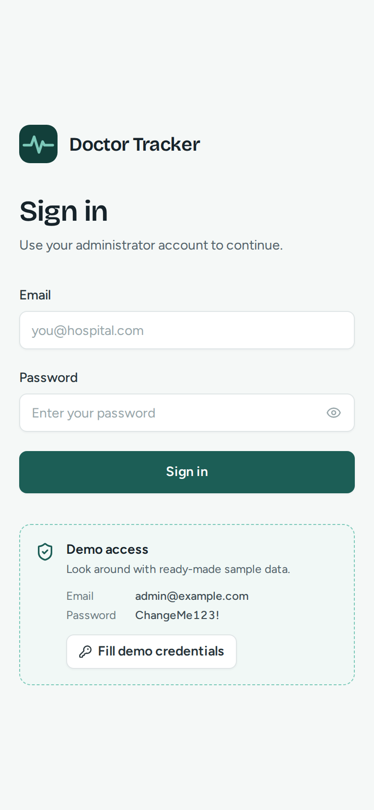 | 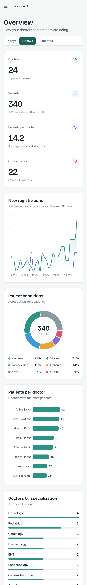 | 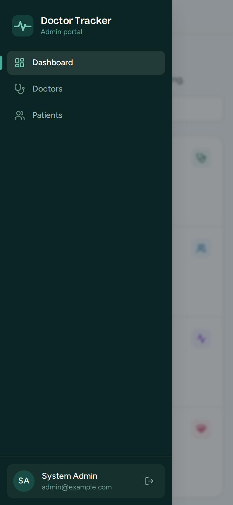 | 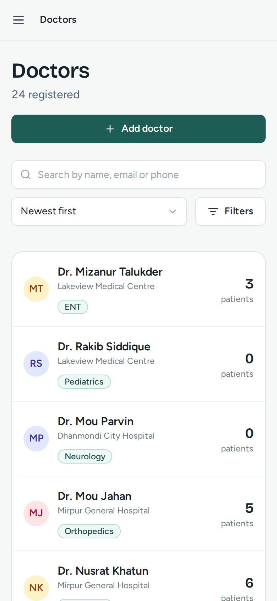 | 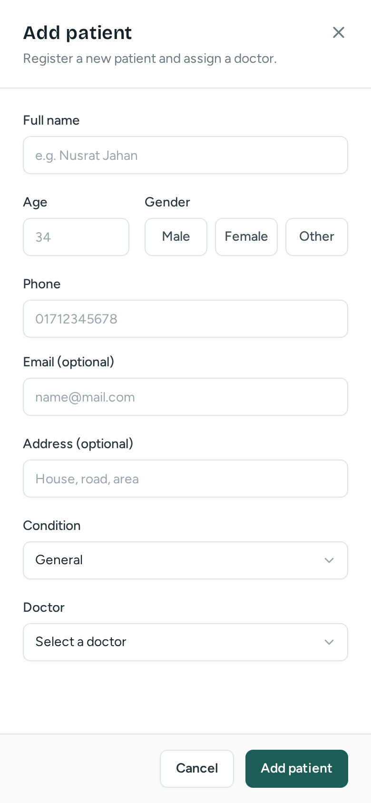 |

---

## Quality checks

- `npm run lint` (Next.js + ESLint core web vitals): clean.
- `npm run build`: production build compiles with no warnings.
- Formatting: Prettier with the Tailwind class-sorting plugin (`npm run format`).
- The API has its own unit and smoke tests (see the backend README).

## Tech stack

Next.js 14 (App Router, middleware, rewrites), React 18, Tailwind CSS 3, TanStack Query 5, Zustand, React Hook Form + zod, Radix UI (Dialog, Dropdown Menu), Recharts, Axios, Sonner, Lucide icons. Fonts: Bricolage Grotesque (headings, numbers) and Figtree (interface).
